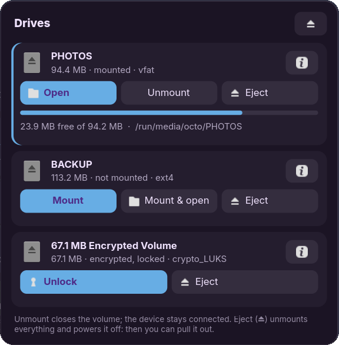
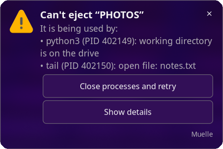
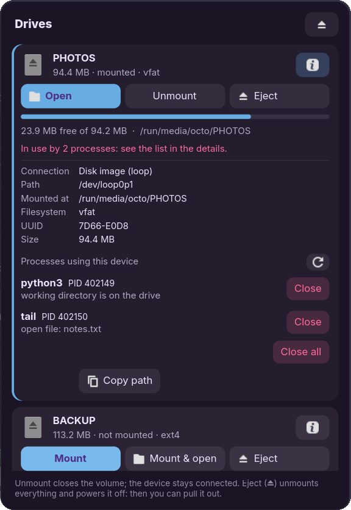
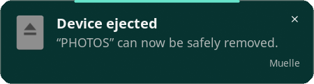

<div align="center">

# Muelle

**Removable drives in your system tray, done right.**<br>
Mount, open and safely eject USB drives — and when something is holding a
drive busy, Muelle tells you *what* it is and closes it for you.



</div>

---

## “Device is busy.” Which program? 🤔

You click *eject* and get the dreaded *target is busy*. Somewhere a terminal
is sitting in that folder, a video player still has a file open, or a
forgotten `python -m http.server` is serving from it. Most tray tools stop at
the error. Muelle keeps going:

<p align="center">
  
</p>

It names every process holding the drive — **name, PID and why** (open file,
working directory, running from the drive, file mapped in memory) — and offers
**Close processes and retry**: a polite `SIGTERM`, a `SIGKILL` only for what's
still alive after 3 seconds, then the eject runs again.

<p align="center">
  
  &nbsp;
  
</p>

Prefer to pick? The panel lists them with a **Close** button each.

## Features

- **Left click** opens a panel with every drive — mounted or not — its size,
  filesystem, free space and details (device, connection, path, UUID, serial
  number, encryption). Buttons for *Mount*, *Mount & open*, *Open*,
  *Unmount*, *Eject* and *Unlock*.
- **Right click** gives a full menu: per-drive actions, *Mount / Unmount /
  Eject all*, *Close the processes using it*, and the settings.
- **Middle click** opens the drive in your file manager when there's just one.
- **Plug-in notification** asks whether to mount (*Mount* / *Mount & open*).
  Optionally, a second one asks whether to open the file manager after
  mounting. Both can be turned on or off.
- **Unmount vs. Eject, explained.** *Unmount* closes the volume and leaves the
  device connected. *Eject* unmounts **every** partition, locks encrypted ones
  and powers the device off, then tells you it's safe to pull out.
- **LUKS encrypted drives** unlock inline: type the passphrase in the panel,
  no extra dialogs.
- **Fits your desktop.** The panel follows your GTK theme, and picks up
  KDE/Noctalia colour schemes live when they change.
- **Small and direct.** One C file and a ~110 KB binary that talks to UDisks2
  over D-Bus: no Python, no helper daemons, no polling. It idles at under
  20 MB of private memory.
- **Speaks your language:** English and Spanish so far
  ([add yours](#translations)).

## Requirements

- A **StatusNotifierItem** tray: Waybar, KDE Plasma, Noctalia, ironbar, the
  XFCE/LXQt/Budgie trays… On GNOME you need the
  [AppIndicator extension](https://extensions.gnome.org/extension/615/appindicator-support/).
- **UDisks2**, which virtually every desktop distribution runs.
- A notification daemon (mako, dunst, swaync, your desktop's own…).
- **GTK 4** and, on Wayland, **gtk4-layer-shell** so the panel can float next
  to your bar (niri, Hyprland, sway, river, KDE…). Without it — on GNOME or
  X11, or when built without it — the panel opens as a normal window.

## Install

### Build dependencies

| Distribution          | Command |
|-----------------------|---------|
| Arch Linux            | `sudo pacman -S --needed base-devel gtk4 gtk4-layer-shell gettext` |
| Fedora                | `sudo dnf install gcc make gtk4-devel gtk4-layer-shell-devel gettext` |
| Debian 13 / Ubuntu 25.04+ | `sudo apt install gcc make libgtk-4-dev libgtk4-layer-shell-dev gettext pkg-config` |
| openSUSE Tumbleweed   | `sudo zypper install gcc make gtk4-devel gtk4-layer-shell-devel gettext-tools` |

Ubuntu 24.04 has no gtk4-layer-shell: drop that package and Muelle builds
anyway, with the panel as a normal window.

### Build and install

```sh
git clone https://github.com/SimonBlancoE/muelle.git
cd muelle
make
sudo make install            # to /usr/local
# or, just for you:
make PREFIX=~/.local install
```

### Start it with your session

Either enable the bundled systemd user service (works with any session that
starts `graphical-session.target`: KDE, GNOME, and niri/Hyprland/sway under
UWSM or similar):

```sh
systemctl --user enable --now muelle.service
```

…or launch it from your compositor's config:

```text
niri:      spawn-at-startup "muelle"
Hyprland:  exec-once = muelle
sway:      exec muelle
```

Only one instance ever runs. Running `muelle` again opens or closes the
panel, so you can bind it to a key.

## Settings

The toggles live in the right-click menu under **Settings**. All of them,
plus a couple more, are in `~/.config/muelle/muelle.ini`:

| Key                | Default | What it does |
|--------------------|---------|--------------|
| `ask_to_mount`     | `true`  | Notification when a device is plugged in: *Mount* / *Mount & open* |
| `ask_to_open`      | `false` | Notification after mounting: *Open* in the file manager |
| `show_internal`    | `false` | Also list partitions on internal disks |
| `always_show_icon` | `false` | Keep the tray icon visible with no drives connected |
| `panel_position`   | `auto`  | `auto` places the panel by the tray icon; or `top-left`, `top-right`, `bottom-left`, `bottom-right` |
| `file_manager`     | *(empty)* | Command to open folders with, e.g. `nautilus` or `kitty -e yazi`. Empty uses the system default |

## How “close the processes” works

To find who is using a drive, Muelle reads `/proc`: every process's open file
descriptors, working directory, executable and memory maps, matched against
the drive's mount points. That is what `fuser -m` does, without shelling out.

- It only sees **your own processes**: other users' and root's aren't readable
  without privileges. If none of yours hold the drive, the message says it's
  probably a system process (an indexer, a backup…) rather than showing an
  empty list.
- Nothing is killed without you asking. The list is shown first, and closing
  is always `SIGTERM` first, `SIGKILL` only after 3 seconds.
- A terminal whose working directory is on the drive shows up as such:
  closing it closes that terminal tab.

## Translations

Strings live in `po/`. To add a language:

```sh
make pot                                   # refresh po/muelle.pot
msginit -i po/muelle.pot -o po/fr.po -l fr
# translate po/fr.po, then:
make && make run                           # run from the tree with translations
```

Pull requests are welcome.

## Why “Muelle”?

*Muelle* is Spanish for a dock or pier: the place where things are loaded
and unloaded. It's also where this started: a friendlier replacement for
[udiskie](https://github.com/coldfix/udiskie) on a niri + Noctalia desktop.

## License

[MIT](LICENSE) © 2026 Simon Blanco
